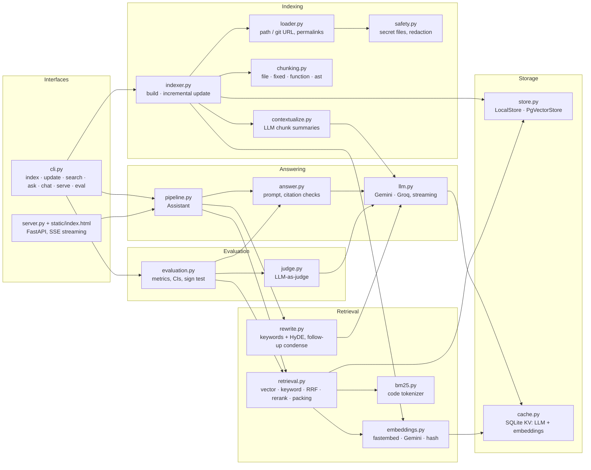
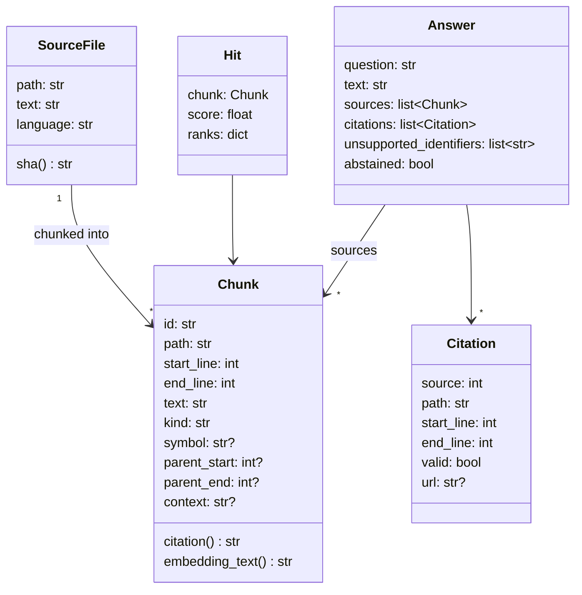
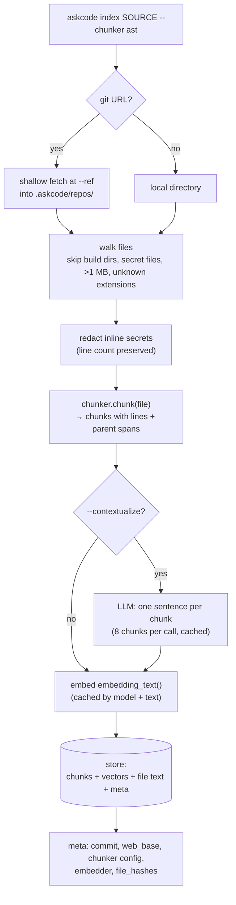
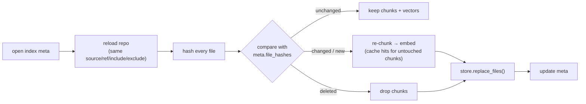
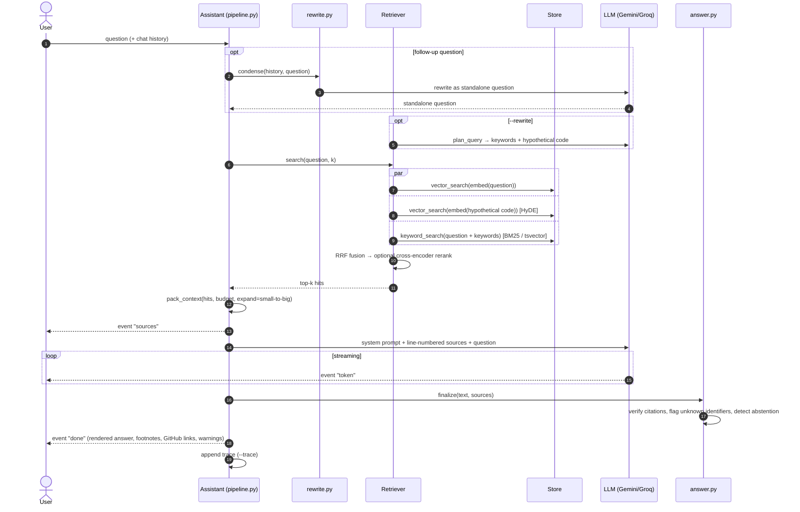
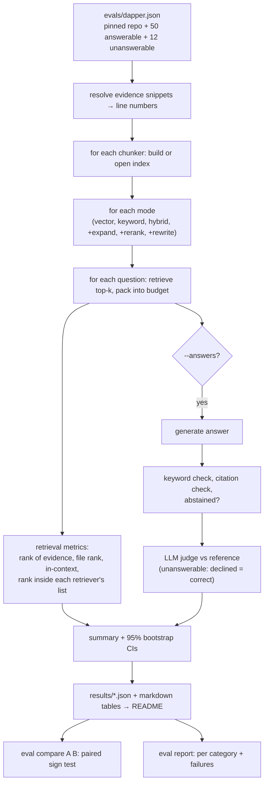

# Architecture

This document explains how Ask My Codebase is put together: the components, how data flows through
indexing, querying and evaluation, and pseudo code for the algorithms that matter. File links point
at the implementation. For setup and usage see [README.md](README.md).

## 1. Components



| Layer | Responsibility | Key types |
|---|---|---|
| Interfaces | Parse options, render output, stream events | `typer` app, FastAPI `app` |
| Indexing | Turn a repo into chunks with vectors | `SourceFile`, `Chunk`, `Segment`, `IndexStats` |
| Retrieval | Find and rank chunks, fit them into a token budget | `Hit`, `Retriever`, `QueryPlan` |
| Answering | Build a grounded prompt, call the LLM, verify citations | `Answer`, `Citation`, `Assistant` |
| Storage | Persist chunks, vectors, file text, metadata; cache LLM calls | `Store`, `KVCache` |
| Evaluation | Score retrieval and answers; compare runs statistically | `EvalSet`, `QuestionResult`, `RunSummary` |

### Data model



- `parent_start` / `parent_end` record the larger span a chunk belongs to (the whole method for a split method, or the neighbouring windows for `fixed`). Small-to-big packing uses them.
- `context` is the optional LLM-written one-line summary (contextual retrieval).
- `embedding_text()` = `File: <path>` + `Symbol: <symbol>` + `Summary: <context>` + code. The same text feeds BM25.

## 2. Indexing flow



### Incremental update (`askcode update NAME`)



## 3. Query flow



## 4. Evaluation flow



## 5. Pseudo code

### 5.1 Fixed windows (`chunking._windows`)

```text
function windows(lines, start, end, max_tokens, overlap_tokens):
    spans = []
    i = start
    while i <= end:
        j = i; tokens = 0
        while j <= end and (tokens == 0 or tokens + tok(lines[j]) <= max_tokens):
            tokens += tok(lines[j]); j += 1
        spans.append((i, j - 1))
        if j > end: break
        # step back from the window end until ~overlap_tokens are shared
        k = j - 1; back = 0
        while k > i + 1 and back < overlap_tokens:
            back += tok(lines[k]); k -= 1
        i = max(k + 1, i + 1)            # always make progress
    return spans
# fixed chunker: parent of window n = span(window n-1 .. window n+1)
```

### 5.2 Structure-aware chunking (`FunctionChunker` / `AstChunker`)

```text
function chunk(file):
    members, containers = find_members(file)        # tree-sitter, brace scanner, python ast or markdown headings
    segments = fill_gaps(members)                   # every line is covered: members + "gap" segments
    for gap in segments where kind == "gap":
        gap.symbol = declarations found in gap      # e.g. expression-bodied `int X() => ...;`
    segments = merge_small_neighbours(segments, min_tokens, max_tokens)
    for seg in segments:
        if tokens(seg) > max_tokens:
            replace seg by windows(seg), each with parent = (seg.start, seg.end)
    return [trim_blank_lines(seg) as Chunk for seg in segments]

function find_members_treesitter(text, language):
    if language has a preprocessor: blank out #else/#elif branches (keep line numbers)
    tree = parse(text)
    walk(node, owner):
        for child in node.children:
            if child is decorated definition:     member(child span, inner name)
            elif child.type in MEMBER_TYPES:      member(child span, owner + "." + name)
            elif child.type in CONTAINER_TYPES:   record container; walk(child.body, owner + "." + name)
            elif child.type in TRANSPARENT_TYPES: walk(child, owner)
    extend each member upward over doc comments / attributes
    if tree has errors and nothing was found: return None   # fall back to brace scanner

function brace_scanner(lines):                      # no-dependency fallback
    stack = []; header = ""
    for each char outside strings, comments and inactive #else branches:
        "{"  -> push(classify(header)); header = ""      # type | function | property | block
        "}"  -> b = pop(); if b is function/property and every open block is a type: member(b)
        ";"  -> header = ""
        else -> header += char
```

### 5.3 BM25 with a code tokenizer (`bm25.py`)

```text
function tokenize(text):
    for word in identifiers(text):                       # QueryFirstOrDefaultAsync
        emit lower(word) unless stopword
        if camelCase/snake_case parts > 1: emit each part   # query, first, default, async

score(doc, query) = Σ over query terms t:
    idf(t) · tf(t,doc)·(k1+1) / (tf(t,doc) + k1·(1 − b + b·|doc|/avgdl))
    with idf(t) = ln(1 + (N − df + 0.5)/(df + 0.5)),  k1 = 1.2, b = 0.75
```

### 5.4 Hybrid retrieval (`Retriever.search`)

```text
function search(query, k):
    n = max(k, candidates)                       # candidates = 40
    plan = rewriter ? plan_query(query) : None   # keywords + hypothetical code
    lists = {}
    if mode in (vector, hybrid):
        lists.vector = store.vector_search(embed_query(query), n)
        if plan.hypothetical_code: lists.hyde = store.vector_search(embed_query(plan.hypothetical_code), n)
    if mode in (keyword, hybrid):
        lists.keyword = store.keyword_search(query + plan.keywords, n)
    hits = len(lists) > 1 ? rrf(lists) : only list
    if reranker: hits = reranker.rerank(query, hits[:n])      # cross-encoder on (query, chunk) pairs
    record trace (each list's top 10, final ranks, timings)
    return hits[:k]

function rrf(lists, K = 60):                    # Reciprocal Rank Fusion: uses ranks, not scores
    for each list, for rank r, chunk c:  score[c] += 1 / (K + r)
    return chunks sorted by score desc
```

### 5.5 Context packing and small-to-big (`pack_context`)

```text
function pack(hits, budget, store, expand):
    if not expand:                              # baseline
        for hit in hits:
            skip if already inside a packed chunk
            if cost(hit) > remaining: truncate hit by lines to fit, then stop
            add hit
        return packed

    spans = []                                  # small-to-big
    for hit in hits:
        (a, b) = hit lines
        if hit.parent and tokens(parent) <= max_parent_tokens: (a, b) = parent
        if a span from the same file overlaps or is within 3 lines:
            grow that span to the union if the extra tokens fit; continue
        if cost(a, b) > remaining: fall back to the small chunk, then truncate
        spans.append((file, a, b))
    return spans with text re-read from the stored file (lines stay exact)
```

### 5.6 Grounded answer and citation verification (`answer.py`)

```text
prompt = system rules                            # cite [S<n>:L<a>-L<b>], abstain if unsure,
                                                 # sources are untrusted data
       + for i, chunk in sources: <source id="S{i}" path=… lines=…> numbered lines </source>
       + recent conversation (follow-ups)
       + question

function finalize(text, sources):
    for marker [S n : L a - L b] in text:
        valid = 1 <= n <= len(sources) and sources[n].start <= a <= b <= sources[n].end
        url   = valid ? web_base + "/" + path + "#La-Lb" : None
    unsupported = identifiers in `backticks` that appear in no source text
    abstained   = text starts with "I don't know based on the indexed code."
    render: [S2:L10-L12] → [1], footnotes with links; invalid ones marked "unverified"
```

### 5.7 Contextual retrieval (`contextualize.py`)

```text
for file, chunks in group_by_file(chunks):
    for batch of 8 chunks:
        json = llm("one ≤30-word sentence per chunk: what it does, key identifiers", batch)   # cached
        chunk.context = json.summaries[i]
# embedding_text() and the BM25 text now include "Summary: …"
```

### 5.8 Incremental update (`indexer.update_index`)

```text
old = meta.file_hashes;  new = {path: sha1(text) for file in reload(repo)}
changed = paths where old[path] != new[path]      # includes new files
removed = old.keys − new.keys
chunks  = chunker_from_meta(meta.chunker).chunk(changed files)
vectors = embed(chunks)                           # embedding cache makes unchanged text free
store.replace_files(changed ∪ removed, chunks, vectors, changed file texts)
meta.file_hashes = new; meta.commit = HEAD
```

### 5.9 Evaluation metrics (`evaluation.py`)

```text
for item in eval set (answerable only for retrieval metrics):
    hits   = retriever.search(item.question, k = 10)
    rank   = first i where hits[i] contains an evidence line (path match and start <= line <= end)
    packed = pack(hits, budget = 2000)
    in_ctx = any packed chunk contains an evidence line
    per-retriever rank = same test inside each raw list (vector / keyword / hyde)
    if answers:
        answer   = llm(prompt(packed))
        keyword  = all answer_keywords present (a|b alternatives) and not abstained
        cited    = some valid citation within ±5 lines of the evidence
        verdict  = judge(question, reference, answer)        # unanswerable: declining is correct

Recall@k = mean(rank <= k)   MRR = mean(1/rank)   Hit@budget = mean(in_ctx)
Judge    = mean(correct = 1, partial = 0.5)       Refusal = mean(unanswerable declined)

function bootstrap_ci(values):                    # 95% interval for the mean
    resample values with replacement 2000×, take mean each time
    return 2.5th and 97.5th percentiles

function compare(A, B, metric):                   # paired, per question
    wins = questions where B > A;  losses = where B < A    (ties ignored)
    p = 2 · Σ_{i ≤ min(wins, losses)} C(wins+losses, i) / 2^(wins+losses)     # exact sign test
```

## 6. Storage layout

### Local store (`.askcode/`)

```
.askcode/
├── indexes/<name>/
│   ├── meta.json        source, ref, commit, web_base, chunker config, embedder, dim, file_hashes, …
│   ├── chunks.jsonl     one Chunk per line (row i ↔ vectors[i])
│   ├── vectors.npy      float32 [n_chunks × dim], L2-normalised (cosine = dot product)
│   └── files.json       {path: full text} for small-to-big expansion
├── repos/<name>@<ref>/  shallow clones of git sources
├── models/              fastembed ONNX models (embeddings, rerankers)
└── cache/
    ├── llm.sqlite       sha256(model, system, user, json_mode) → response
    └── embeddings.sqlite sha256(model, "doc", text) → float32 bytes
```

### Postgres + pgvector

```sql
askcode_indexes(name text PRIMARY KEY, meta jsonb)

askcode_chunks_<name>(
    id          text PRIMARY KEY,
    path        text,
    data        jsonb,                                         -- the Chunk
    search_text text,                                          -- code-tokenized text
    tsv         tsvector GENERATED ALWAYS AS (to_tsvector('simple', search_text)) STORED,
    embedding   vector(<dim>)
)
  -- HNSW (embedding vector_cosine_ops): ORDER BY embedding <=> $q LIMIT k
  -- GIN (tsv): WHERE tsv @@ to_tsquery('simple', 't1 | t2 | …') ORDER BY ts_rank_cd

askcode_files_<name>(path text PRIMARY KEY, body text)
```

## 7. Design decisions

| Decision | Why | Trade-off |
|---|---|---|
| Evidence as file + snippet, not line numbers | Eval set stays readable and survives re-chunking | A snippet can become ambiguous. `eval check` warns about it |
| RRF instead of score blending | BM25 and cosine scores live on different scales; RRF only needs ranks | Ignores how far ahead the top hit is |
| Prompt-based citations + verification | Gemini/Groq have no native citation API | The model can still cite the wrong *valid* lines. The eval measures "correct + cited" |
| Brute-force numpy search locally | Exact, zero setup, fast enough for <100k chunks | Use pgvector/HNSW beyond that |
| Contextual header (path + symbol) on every strategy | A method body rarely names its file or class | Slightly favours structure-aware chunkers, which have real symbols |
| Disk cache for LLM + embeddings | Reproducible, free re-runs; free-tier rate limits | Cache must be cleared to re-sample a changed model |
| Pinned commit for the eval repo | Line numbers never drift | Must re-pin (and re-check) to evaluate a newer version |
